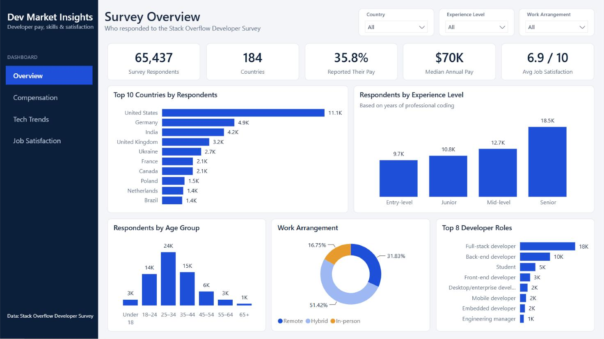
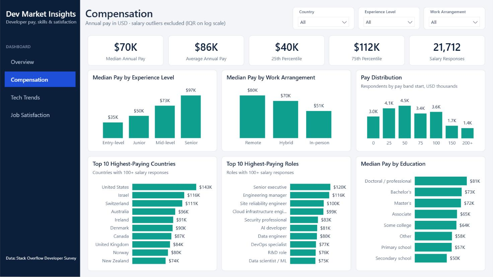
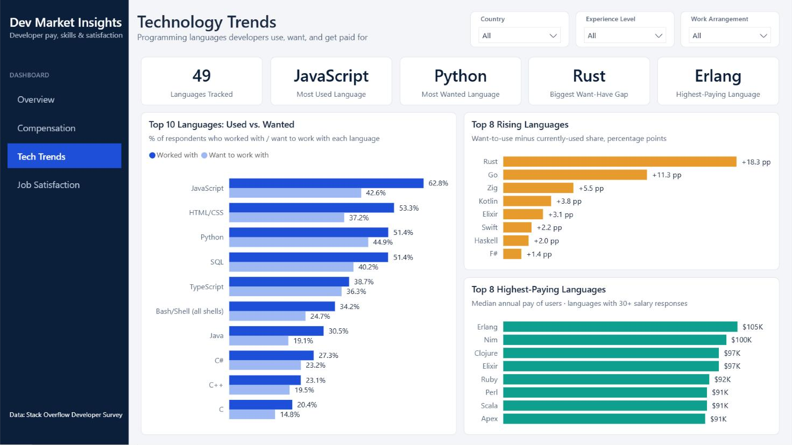
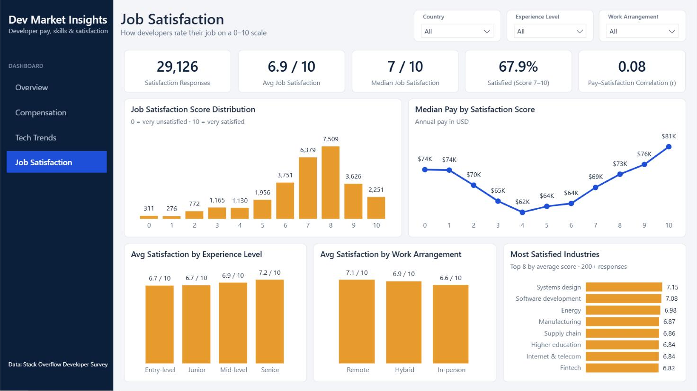

# Phase 4: Power BI Dashboard

**Project:** Developer Market Trends & Salary Drivers

I bring the findings from Phases 1-3 together in one interactive Power BI dashboard. It
has 4 pages, a side navigation bar, and 3 slicers (Country, Experience Level, Work
Arrangement) that stay in sync across every page.

**Live dashboard:** [View on Power BI](https://app.powerbi.com/groups/me/reports/e378ce91-9ee0-4d3c-9c20-b2764bd2778f?ctid=a74aa7fa-f7f9-4020-a84a-057abbba6e9b&pbi_source=linkShare)

## Dashboard

### 1. Survey Overview

Who took the survey: respondents, countries, experience, age, work arrangement, and roles.

### 2. Compensation

Median pay by experience, work arrangement, country, role, and education, plus the pay
distribution.

### 3. Tech Trends

The most used and most wanted languages, the biggest want-vs-have gaps, and the
best-paid languages.

### 4. Job Satisfaction

How developers score their job (0-10), and how that changes with pay, experience, work
arrangement, and industry.

## How I Built It

- **Data:** `data/survey_data_eda_ready.csv` (Phase 2's output), loaded with Power Query.
- **Model:** a `Survey` table (one row per respondent), a `Languages` table (one row per
  respondent, language, and "Worked with" / "Want to work with" status, split from the
  multi-select fields), and a `Key Measures` table with all DAX measures.
- **Pay:** every pay number uses `PayUSD`, which leaves out the 1,723 outliers flagged in
  Phase 2 (IQR on the log scale). That is why the median is $70,000, not $65,000.
- **Top N charts:** countries and roles need 100+ salary responses, languages need 30+,
  and industries need 200+ satisfaction responses, so small groups don't top the list.
- **Format:** a single Power BI file (`.pbix`) with the data model, DAX measures, report
  pages, and custom theme inside it.

## How to Open

1. Install [Power BI Desktop](https://powerbi.microsoft.com/desktop/).
2. Open `dev_market_dashboard.pbix`. The data is stored in the file, so the dashboard works
   right away.

To refresh the data, run Phases 1 and 2 first, so `data/survey_data_eda_ready.csv` exists.

## Files

| Path | What it is |
| --- | --- |
| `dev_market_dashboard.pbix` | The dashboard. Open this file in Power BI Desktop |
| `images/` | Dashboard screenshots |
